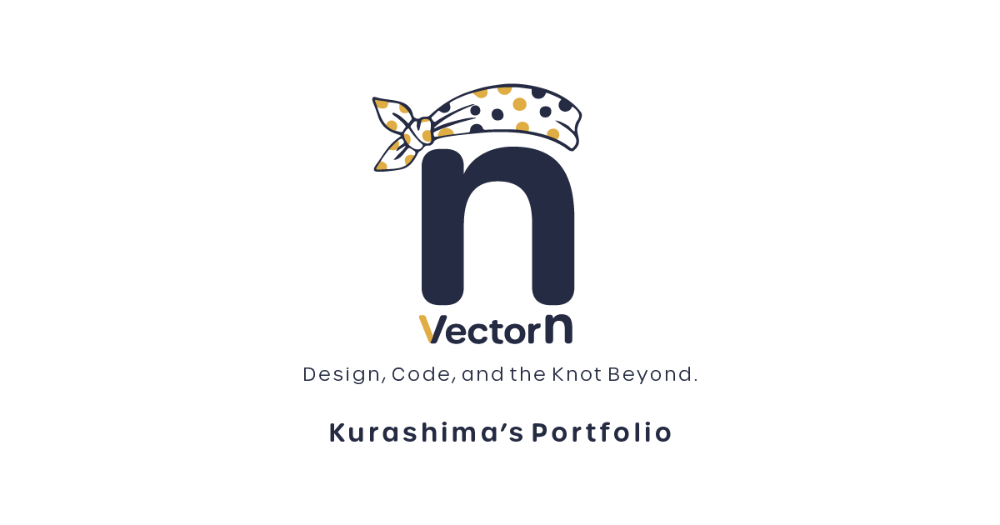

# VectorN — Portfolio

<div align="center">



**デザインと実装、その先にある「運用」までを設計する。**

見た目の美しさだけでなく、更新する人、使う人、育てていく人のことまで考える。

[](https://nextjs.org/)
[](https://www.typescriptlang.org/)
[](https://tailwindcss.com/)
[](https://motion.dev/)

</div>

---

## 📖 About This Project

VectorNは、Next.jsとWordPress REST APIを組み合わせて構築した、個人の制作実績を紹介するポートフォリオサイトです。

従来のWordPressサイトをヘッドレスCMS構成へ移行し、コンテンツ管理とフロントエンドの表示処理を分離しました。

主な機能は以下のとおりです。

- WordPress REST APIを利用した制作実績の取得・表示
- カテゴリー別の実績一覧と詳細ページ
- パスワード保護された制作実績の閲覧フロー
- レスポンシブデザインとスクロールアニメーション
- お問い合わせフォームとSEO対応

### Concept — なぜこのデザインで、なぜこの技術を選んだのか

このプロジェクトは、転職活動と並行した技術学習の一環として、「ただ動くものを作る」だけでなく、**「なぜその技術や設計を選ぶのか」という意思決定のプロセスを鍛えること**を目的に着手しました。

技術選定、UI設計、アニメーション演出、API連携、SEO、メール送信機能まで一貫して取り組み、フロントエンドを中心に、バックエンドとの連携や運用設計への理解を深めています。

---

## 🛠 Tech Stack

| カテゴリ    | 技術                      | 選定理由                                             |
| ----------- | ------------------------- | ---------------------------------------------------- |
| Framework   | Next.js 16 (App Router)   | Server Componentsの活用と柔軟なレンダリング設計      |
| Language    | TypeScript                | 型安全性の確保とWordPress REST APIレスポンスの型定義 |
| Styling     | Tailwind CSS v4           | 一貫したスタイリングと保守しやすいUI実装             |
| Animation   | Framer Motion             | Reactと親和性の高い宣言的アニメーション              |
| UI Library  | shadcn/ui                 | Radix UIを活用した柔軟なコンポーネント設計           |
| CMS         | WordPress REST API / ACF  | 既存コンテンツの活用と管理画面による更新性の維持     |
| Opening     | Lottie / lottie-react     | After Effectsで制作したアニメーションのWeb実装       |
| Mail        | Resend                    | Server Actionと連携したメール送信                    |
| Analytics   | GA4 / @next/third-parties | アクセス解析機能の統合                               |
| Development | Docker                    | ローカル開発環境の構築と設定の共通化                 |
| Deployment  | Vercel                    | Next.jsアプリケーションのデプロイと公開              |

---

## 🎬 Key Features

### 1. GSAPからFramer Motionへ — 技術選定の見直し

当初、スクロール連動アニメーションにはGSAP / ScrollTriggerを採用していました。

しかし、実装を進める中で、以下の課題を感じました。

- DOM参照やアニメーションの初期化・破棄を管理する必要があった
- ページ遷移時のアニメーション制御が複雑になった
- コンポーネントの状態とアニメーション処理を整理しにくかった

そこで、主要なアニメーションをFramer Motionへ移行しました。

`motion`コンポーネントや`variants`を利用することで、アニメーションの振る舞いをコンポーネント内で宣言的に記述し、可読性と保守性の向上を図りました。

```tsx
// Before: GSAPによる命令的なアニメーション
useGSAP(() => {
  gsap.fromTo(
    ref.current,
    { opacity: 0 },
    {
      opacity: 1,
      scrollTrigger: {
        trigger: ref.current,
      },
    },
  );
});

// After: Framer Motionによる宣言的なアニメーション
<motion.div
  initial={{ opacity: 0, y: 24 }}
  whileInView={{ opacity: 1, y: 0 }}
  transition={{ duration: 0.6, ease: "easeOut" }}
  viewport={{ once: true }}
/>;
```

※上記は設計の違いを示す簡略化した例です。

GSAPにも高度なタイムライン制御などの強みがありますが、今回のサイトではReactコンポーネントとの親和性と保守性を優先しました。

### 2. After EffectsとLottieによるオープニングアニメーション

オープニングアニメーションは、After Effectsで制作したモーションをBodymovinでJSON形式に書き出し、`lottie-react`を通じて実装しました。

ベクター表現を活用することで、画面サイズや解像度の異なる環境でも鮮明な描画を目指しています。

### 3. 制作実績のパスワード保護機能

公開範囲を限定したい制作実績に対応するため、WordPressのパスワード保護機能と、shadcn/uiのDialogコンポーネントを組み合わせた閲覧フローを実装しました。

- パスワード保護状態に応じた表示の切り替え
- 詳細ページでのパスワード入力UI
- WordPress REST APIと連携したコンテンツ取得

認証処理とコンテンツへのアクセス制御は、サーバー側・クライアント側それぞれの役割を考慮して設計する必要があります。

### 4. RepositoryパターンによるAPIアクセスの集約

WordPress REST APIへのアクセスを`worksRepository`に集約しました。

ページコンポーネントからAPIの取得処理を分離することで、データ取得方法の変更や機能追加に対応しやすい構成を目指しています。

```ts
const categories = await worksRepository.getAllCategories();
const works = await worksRepository.getWorksByCategory(slug);
```

CMSを変更する場合にはAPI実装やデータ変換、型定義の調整が必要ですが、ページ側への影響を抑えやすい設計としています。

---

## 🔍 SEO & Performance

- **サイトマップ**：`sitemap.ts`を利用したサイトマップ生成
- **robots.txt**：`robots.ts`によるクローラー向け設定
- **メタデータ**：Next.js Metadata APIによるタイトルやOGP情報の設定
- **画像最適化**：`next/image`を利用した画像表示の最適化
- **アクセス解析**：`@next/third-parties`を利用したGoogle Analytics 4の導入
- **レンダリング**：ページの特性に応じたServer ComponentsとClient Componentsの使い分け

---

## 📁 Project Structure（抜粋）

```text
.
├── app/
│   ├── page.tsx
│   ├── works/
│   │   ├── page.tsx
│   │   └── [category]/
│   │       ├── page.tsx
│   │       └── [slug]/
│   │           └── page.tsx
│   ├── contact/
│   │   └── page.tsx
│   └── features/
│       └── works/
│           └── api/
│               ├── repository.ts
│               └── types.ts
├── components/
│   ├── top/
│   │   ├── LatestWorksSection.tsx
│   │   └── WorksSection.tsx
│   └── works/
│       ├── WorkCard.tsx
│       └── PageShell.tsx
└── package.json
```

※主要ファイルのみを抜粋しています。

---

## 🚀 Getting Started

### Requirements

- Node.js（`package.json`およびNext.jsの対応バージョンに準拠）
- npm
- WordPress REST APIにアクセスできる環境

### Installation

```bash
# リポジトリのクローン
git clone https://github.com/shitsurae-lab/vector-n.git
cd vector-n

# lockfileに基づく依存関係のインストール
npm ci --include=optional

# 環境変数の設定
cp .env.example .env.local

# 開発サーバーの起動
npm run dev
```

`.env.local`には、利用するWordPress REST APIなどの接続情報を設定してください。

環境変数名や必要な設定値は、実際のアプリケーション構成に合わせて確認してください。

### Production Build

```bash
npm run build
```

### Docker

Dockerによる開発環境も用意しています。

```bash
docker compose up
```

ローカル環境では、使用しているマシンのリソースに合わせてDockerのメモリ設定を調整しています。

---

## 🔧 Troubleshooting

### Intel MacでLightning CSSのネイティブモジュールが見つからない場合

macOSのIntel環境では、Lightning CSSのネイティブモジュールが不足していると、ビルド時に次のようなエラーが発生する場合があります。

```text
Cannot find module '../lightningcss.darwin-x64.node'
```

まず、実行環境とインストール状況を確認します。

```bash
node -p "process.platform + '-' + process.arch"
npm ls lightningcss lightningcss-darwin-x64
```

`package-lock.json`に必要なプラットフォーム向け依存関係が記録されているかも確認してください。

依存関係を再構築する場合は、既存のlockfileをバックアップし、パッケージのバージョン変更を確認したうえで実施してください。

再構築後は、次のコマンドでインストールとビルドの再現性を確認します。

```bash
npm ci --include=optional
npm run build
```

---

## 🗺 Development History

| フェーズ       | 主な取り組み                                 |
| -------------- | -------------------------------------------- |
| 基盤構築       | Next.js App RouterとWordPress REST APIの連携 |
| UI実装         | レスポンシブ対応、実績一覧・詳細ページ       |
| アニメーション | GSAPからFramer Motionへの移行                |
| API設計        | RepositoryパターンとTypeScriptによる型定義   |
| Lottie         | After Effects製アニメーションの実装          |
| SEO            | サイトマップ、OGP、robots.txt                |
| メール         | ResendとServer Actionの連携                  |
| 機能改善       | 最新実績セクションの追加、UIの改善           |
| 開発環境       | 依存関係の見直しとビルドの再現性確認         |

---

## 💭 振り返りと今後

このプロジェクトを通じて強く意識したのは、**「動くこと」と「継続して改善できること」は別の課題である**という点です。

GSAPからFramer Motionへの移行は、機能を実現したあとでも、保守性・可読性・Reactとの親和性という観点から設計を見直した経験でした。

また、WordPress REST APIとの連携やRepositoryパターンの導入を通じて、UIだけでなく、データ構造や更新・運用のしやすさまで考える重要性を学びました。

今後は、キャッシュ・再検証戦略の整理やE2Eテスト（Playwright）の導入を検討し、品質と保守性の向上に取り組んでいきます。

---

<div align="center">

**このREADMEを読んでくださった方へ**

技術のことでも、お仕事のことでも、お気軽にご連絡いただければ嬉しいです。

[Contact](https://www.vector-n.net/contact)

</div>
